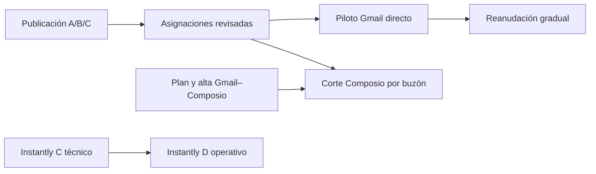

# Roadmap operativo y frentes paralelos — 05/11/2026

SDD STRICT · modo planificación. El usuario solicita acelerar el trabajo en otros chats e incluir el alta Gmail–Composio en los pendientes. Esta entrega actualiza el plan; no crea chats/worktrees, transfiere archivos, implementa el alta ni autoriza operaciones reales.

## Prioridad y punto de partida

La prioridad ya confirmada es empezar un piloto con Gmail directo. No hace falta terminar Composio o Instantly para ese piloto. Las decisiones D01–D24 y la restricción de conservar lo aceptado siguen vigentes; no hay una nueva decisión de negocio que requiera repetir preguntas. Las preguntas específicas del alta se resolverán al preparar ese incremento, no se presuponen en este roadmap.

- 049 y su postflight: [catálogo aceptado](s02/release/abc-final/catalog-variants/application-result-review.md). No repetir 048, 049 o sus diagnósticos.
- Web/worker: [candidato ABC-WW-20261105](s02/release/web-worker-20261105/manifest.json) preparado, árbol 8c9690dbe5c4421f709608f5e51062a140f42f3b62ddabd1ff586d7885ad6710. No publicado; faltan build Linux, QA visual/teclado y controles de transición/arranque.
- Asignaciones reales y piloto: por preparar/ejecutar en el orden siguiente. No se deducen marcas o permisos de dominios, M1/M2 o fixtures.
- Composio: asociación técnica/reglas/verificador inyectable preparados; transporte real deshabilitado. **El alta OAuth de un Gmail desde el CRM aún no está implementada.**
- Instantly: A/B aceptadas dentro de sus alcances; C técnica y D operativa pendientes. 43 consumidas; los permisos/remanentes anteriores no se transfieren.
- Recepción, conversaciones, vista previa/descarga de adjuntos e importación/verificación aceptadas se reutilizan como evidencia; no se reconstruyen ni se repiten por abrir chats.

## Pendientes y dependencias

| ID                | Entrega                                                                   | Qué se puede adelantar ahora                                                                                                                   | Dependencia para usarla realmente                                                                                                                                                           |
| ----------------- | ------------------------------------------------------------------------- | ---------------------------------------------------------------------------------------------------------------------------------------------- | ------------------------------------------------------------------------------------------------------------------------------------------------------------------------------------------- |
| R01               | Publicar el código conjunto A/B/C de web y worker.                        | Build/QA y revisión del candidato bajo sus límites; preparar orden de publicación.                                                             | Checks y autorización de push/deploy/arranque. No exige otra 049.                                                                                                                           |
| R02               | Asignaciones reales de marca, usuario, rol y buzón.                       | Diseñar la matriz y el checklist de revisión MFA, usando alias/datos ficticios en documentos públicos.                                         | Aplicarlas con la UI publicada y permisos propios; confirmar las identidades reales de manera privada.                                                                                      |
| R03               | Piloto pequeño de correo directo con respuesta incorporada al expediente. | Protocolo, criterios, escenarios de error, destinatario controlado y presupuesto propuesto; mocks si se autoriza su implementación.            | R01/R02 y autorización concreta de mensajes, llamadas y procesamiento del worker. No reactivar toda la cola para probar un mensaje.                                                         |
| R04               | Reanudar gradualmente el worker y la operación.                           | Revisar tipos de jobs, legado, sending/uncertain, autoarranque y criterios de detención.                                                       | Piloto aceptado y control de ejecución ensayado. El proceso actual puede iniciar varios jobs: no se inventa un flag de pausa ni se promete cero tráfico al arrancarlo.                      |
| R05 / S02-CONNECT | Conectar Gmail con Composio desde el CRM.                                 | Discovery y SDD del botón, consentimiento, retorno e identificación de cuenta; aclarar creación de cuenta nueva frente a asociación existente. | Implementación offline aprobada y pruebas del alta real con presupuesto propio. R02 gobierna acceso/marca; publicar la versión requerida antes de ofrecer la UI.                            |
| R06 / T02-03/04   | Activar Composio por buzón y comprobar continuidad de lectura/escritura.  | Diseñar corte, escritor único, identidad, recepción/dedup, errores y recuperación; conservar IDs y pendientes.                                 | R05 para cuentas nuevas, asociación/evidencia válidas y autorización del corte. Gmail directo permanece activo hasta ese paso. No repetir los pilotos ya aceptados salvo el delta concreto. |
| R07 / INS-C       | Prueba técnica de webhook Instantly.                                      | Revisar lo ya implementado, manifiesto y presupuesto pendiente con mocks.                                                                      | Autorización de activación temporal, único ensayo y limpieza; mantener el ledger global en 43 hasta entonces.                                                                               |
| R08 / INS-D       | Prueba operativa Instantly de envío/respuesta/detención.                  | Definir contrato, criterios y presupuesto; no ejecutar ni anticipar capacidad de detención individual no demostrada.                           | C y capacidades requeridas acreditadas, remitente/destinatarios/horario/cupo revisados y autorización de mensajes propia.                                                                   |

R03 es un piloto mínimo del flujo existente con Gmail directo: no equivale al cierre completo de S03 ni de sus secuencias personales Composio. R05/R06 y R07/R08 son vías paralelas posteriores; no se colocan como requisito artificial para empezar ese piloto.

## Reparto recomendado: tres chats inicialmente

| Frente                         | Responsable propuesto                                 | Trabajo propio al arrancar                                                                                                      | Archivos que puede escribir en esa preparación                                                                                                                                        |
| ------------------------------ | ----------------------------------------------------- | ------------------------------------------------------------------------------------------------------------------------------- | ------------------------------------------------------------------------------------------------------------------------------------------------------------------------------------- |
| F1 · Integración y publicación | Este chat coordinador.                                | Candidate/build/QA, compatibilidad, estado global y recepción de entregas.                                                      | Documentos raíz y release; compartidos de producto solo bajo el alcance vigente y una ventana de integración revisada.                                                                |
| F2 · Alta Gmail–Composio       | Un chat nuevo, con worktree aislado.                  | Solo discovery/SDD de R05; leer identidad, marcas, C1/C2 y transporte existente.                                                | Solo `docs/specs/pipeline-os/s02/connect-gmail/**`. Nuevos módulos/tests se propondrán en un manifiesto futuro; no se transfieren todavía.                                            |
| F3 · Piloto operativo y QA     | Un chat nuevo, inicialmente de revisión.              | R02/R03/R04: matriz de preparación, protocolo del piloto, revisión visual del delta y plan de arranque, sin operaciones reales. | Solo `docs/specs/pipeline-os/operations-pilot/**`; capturas ficticias/resultados locales en su propio checkout. Cualquier defecto se reporta, no se corrige en un archivo compartido. |
| F4 · Instantly C/D, opcional   | Cuarto chat si el usuario quiere mantener ese frente. | Planificación offline de R07/R08 a partir de los contratos actuales.                                                            | Solo `docs/specs/pipeline-os/s00/parallel-cd/**`. No abre/copia .local, credenciales, journal o contadores del coordinador.                                                           |

La QA de F3 puede avanzar mientras F1 revisa el build y F2 diseña el alta. F1 conserva las correcciones de producto; así F3 no cambia lo que F1 está sellando. Conviene añadir F4 después de repartir los tres frentes principales, para no fragmentar la ruta de operación inmediata.

El plan original contempla más trabajo de SMS, seguimiento, asistente, análisis, lenders y fidelización. No se declara que esas funciones estén ausentes: antes de abrir uno de esos frentes se revisa qué existe y qué requisito queda realmente pendiente. No se reconstruyen módulos ya operativos para llenar un sprint.

## Reglas para no solaparse

1. Un chat que programe trabaja en su propia carpeta/worktree y rama `codex/...`. Bifurcar contexto y aislar archivos son decisiones distintas. La documentación oficial describe el fork como historia compartida y el worktree como contexto aislado: [OpenAI](https://developers.openai.com/blog/mastering-codex-remote-for-engineering).
2. Antes de escribir código, el coordinador fija una base pública actual y se comprueba por hashes en cada nuevo worktree. El HEAD actual fb9f201 no incluye por sí solo el WIP A/B/C preparado. No asumir que un fork copió esos cambios. Una base WIP local futura no es un release ni permiso de push.
3. No trabajar en la misma carpeta desde dos chats. Una copia aislada tampoco elimina conflictos de integración: cada archivo tiene un único propietario. Los cambios nuevos se entregan contra su base y el coordinador los revisa antes de incorporarlos.
4. `src/components/integrations.tsx`, `src/lib/server/google.ts`, modelos/roles compartidos, rutas actuales, worker, Dockerfiles, package/lock, AGENTS y migraciones permanecen bajo coordinación. F2/F3/F4 proponen sus cambios; no los editan por heredar este contexto.
5. No se cambia el código del candidato mientras se valida sin declarar una revisión nueva, nuevo digest y la regresión pertinente. Los documentos de planificación pueden avanzar por separado.
6. Los contadores/credenciales y los efectos remotos tienen un único operador coordinado. No se heredan autorizaciones de S00, publicación, OAuth o SQL en los nuevos chats. Sin APIs reales, envíos, SQL remoto, push o deploy por arrancarlos.
7. El repositorio conserva todos los cambios previos. No reset/stash/clean, merge automático o rebase destructivo para preparar la base. No copiar env, .local, adjuntos privados o datos de clientes entre checkouts.
8. Entrega de cada frente: FR/AC/T, rutas tocadas, base, hashes, decisiones, checks efectivamente ejecutados, diferencias/pendientes y propuesta de integración. La planificación no se marca como producto terminado.

### El chat S01 que ya existe

Se revisó el último turno completado de **Pipeline OS — S01: identidad y estados**. Entregó I02 con sus pruebas locales; el coordinador integró después su alcance A. El worktree `codex/s01-foundations` sigue apuntando al commit ae0c42c… y conserva su trabajo separado. No se le asigna R05 por título ni se reutiliza ese estado como base actual sin conciliación. No se editó el checkout ni se enviaron mensajes a ese chat.

## R05 añadido al backlog: alcance mínimo y separación de etapas

**S02-CONNECT-T01 — pendiente de preparación del incremento.** Objetivo: pulsar Conectar Gmail con Composio en el CRM, autorizar el Gmail correcto, validar el retorno/identidad y registrar su asociación con permisos/marca revisados. Reutiliza un proyecto/credencial del servidor y la configuración Gmail apropiada; cada buzón conserva su conexión individual. No crea una API key por buzón ni expone claves en el navegador.

Antes de implementar se deben resolver: quién puede iniciar/completar el alta, cómo se identifica la cuenta CRM nueva o existente, consentimiento multicuenta, cancelación/expiración/reintento, devolución de otra identidad, reconexión sin duplicación y permisos posteriores. No se decide aquí un esquema nuevo, una migración 050, scopes o un coste.

Aceptación mínima futura: no reemplazar otra cuenta, impedir retorno de otra sesión/usuario, comprobar correo correcto, manejar doble callback sin duplicar, respetar el aislamiento por marca y no activar entregas por completar OAuth. Cuenta conectada no equivale a cuenta habilitada para operar. La selección de Composio como transporte se prepara y autoriza en R06, conservando escritor único y el control de pendientes.

## Encargos para copiar al abrir los chats

Usarlos después de preparar/verificar la base aislada. Si el nuevo chat encuentra una base antigua o la carpeta del coordinador compartida, comienza en modo solo lectura y lo informa; no copia material privado ni sobrescribe archivos para aparentar igualdad.

### Chat F2 — conexión Gmail–Composio

> Prepara solamente el discovery y la especificación SDD STRICT de S02-CONNECT-T01. Lee AGENTS, parallel-development.md y parallel-roadmap-20261105.md, más los contratos existentes de identidad, marcas, bindings y transporte. Revisa lo ya construido y pregunta únicamente decisiones nuevas del alta. Trabaja en tu worktree verificado y escribe solo docs/specs/pipeline-os/s02/connect-gmail/**. Propón UX, FR/AC, casos negativos, límites de API y manifiesto de implementación futura; no implementes, crees enlaces OAuth, abras env/.local de otro checkout, actives Composio, cambies compartidos, ejecutes SQL remoto o hagas push/deploy. Conserva Gmail directo y 43 peticiones Instantly. No repitas 049 ni los pilotos aceptados.

### Chat F3 — operación y piloto

> Prepara siguiendo SDD el protocolo R02/R03/R04 y la revisión QA del delta A/B/C. Usa la app y las evidencias existentes; recepción, adjuntos e importación ya fueron aceptados. Escribe solo docs/specs/pipeline-os/operations-pilot/** con datos ficticios o alias. Define matriz marca/rol/buzón, criterios del piloto directo, presupuesto propuesto de mensajes/llamadas y un arranque controlado compatible con el worker real. No configures cuentas reales, arranques servicios, verifiques leads, envíes correos, cambies código compartido o ejecutes APIs/SQL/push/deploy. Reporta las limitaciones reales del entorno y respeta cualquier detención de seguridad de computer use. Los mocks y la planificación no cuentan como piloto real ni reanudación autorizada.

### Chat F4 opcional — Instantly C/D

> Revisa y prepara únicamente el siguiente bloque offline de Instantly C/D siguiendo SDD. Lee los contratos y resultados públicos actuales. Escribe solo docs/specs/pipeline-os/s00/parallel-cd/**. Conserva la base de 43 peticiones; no abras ni copies registros privados o credenciales de otro checkout, reinicies contador, generes recursos, actives webhook/campañas o hagas llamadas reales, envíos, verificaciones pagas, SQL remoto, push o deploy. Define dependencias, aceptación y presupuesto propuesto; entrega cambios necesarios como propuesta al coordinador. La implementación y las operaciones reales necesitan su alcance posterior.

## Trazabilidad y verificación de esta planificación

| Requisito / aceptación                                                       | Evidencia                                                                                                   |
| ---------------------------------------------------------------------------- | ----------------------------------------------------------------------------------------------------------- |
| PAR2-FR01 / AC01: pendientes y dependencias actuales, sin repetir aceptados. | R01–R08 ligados al candidato, postflight y contratos existentes.                                            |
| PAR2-FR02 / AC02: trabajo paralelo sin archivos con dos propietarios.        | F1–F4, rutas de escritura propuestas y ventana de integración única.                                        |
| PAR2-FR03 / AC03: alta Composio explícita y distinta de activación.          | R05/R06, S02-CONNECT-T01 pendiente y criterios mínimos, sin implementar el flujo.                           |
| PAR2-FR04 / AC04: preservar base/trabajo/permisos y evitar forks antiguos.   | Revisión Git/worktree y del chat S01; se requiere comparar base por hash antes de programar.                |
| PAR2-FR05 / AC05: planificación no ejecuta operaciones reales.               | Sin nuevos chats/worktrees, código, cuentas, migraciones, APIs de proveedores, mensajes, push o despliegue. |

Esta revisión usa fuentes públicas del repositorio, resultados aportados antes por el operador y una lectura del historial del chat S01. La consulta de documentación pública de OpenAI no usa credenciales del CRM o proveedores. Se verifican enlaces, formato y preservación; no se repiten tests de producto por cambios documentales.

Siguiente acción propuesta: preparar la base común actual preservando WIP y, bajo una instrucción de abrirlos, crear los dos chats F2/F3 con aislamiento y encargos anteriores. Este documento no los crea ni concede permisos de implementación.
