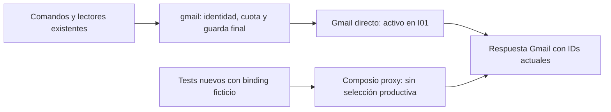

# Diseño S02-I01 — transporte, compatibilidad y frontera S01

Implementación local autorizada31/10/2026. Concreción de contrato antes del código: execute recibe recurso relativo y RequestInit compatible; el adaptador directo no altera opciones previas. Composio exige fetch explícitamente inyectado, binding inmutable con identidad verificada coincidente, revisión y quotaProjectId, y clave solo por argumento servidor. No existe lector de env/config o resolvedor DB Composio en I01. La fachada fija gmail_oauth y conserva el orden actual. Las listas vacías messages/history se admiten según su contrato (data={} puede ser respuesta de listado vacío); los recursos unitarios exigen identidad/datos mínimos. Los errores externos conservan incertidumbre después del intento y nunca contienen cause o texto del proveedor. No se interpretan headers desconocidos del envelope como Retry-After Google.

31/10/2026 · STRICT · Implementado y probado offline bajo autorización S02-I01. [Spec](spec.md), [decisión](adr-001-transporte-compatible.md), [evidencia](verification.md).

## Arquitectura existente y cambio mínimo

`worker/gmail.ts`, `gmail-archive.ts`, `gmail-sending-usage.ts` y los lectores de adjuntos/firmas del servidor llaman a la fachada `gmail`. La fachada obtiene OAuth mediante `gmailToken`, conserva caché/organización/proyecto, espera pacing, reserva `reserve_gmail_api`, ejecuta `beforeRequest` y llama al endpoint Gmail. `sendNext` usa ese callback para `recheck_outbox_delivery` y marca `sendAttempted` antes del POST. No mover esa decisión al proveedor ni cambiar el tratamiento de uncertain/Message-ID.

La nueva frontera encapsula HTTP. No contiene autorización comercial, inscripción en campaña, persistencia, reintentos de cola ni inferencia de marca. Se mantiene Google OAuth en google.ts; no se extraen tokens a contratos compartidos con cliente. Los módulos no deben importarse desde componentes cliente ni desde domain.ts.

## Manifiesto de implementación local

| Ruta desde raíz | Acción y límite |
|---|---|
| `src/lib/server/google.ts` | Único existente a editar en I01: delegar HTTP directo, conservando exports/firma, OAuth, caché, reserva, hook, razones Gmail y throttling. No añadir selección Composio real. |
| `src/lib/server/mail-transport/contract.ts` | Request/resultado internos y binding solo servidor. |
| `src/lib/server/mail-transport/gmail-direct.ts` | Ejecución HTTP compatible; no segundo refresco OAuth ni segunda reserva. |
| `src/lib/server/mail-transport/composio-proxy.ts` | Proxy acotado/injectable y desempaquetado; no lectura de env, DB o journals. |
| `src/lib/server/mail-transport/errors.ts` | Fallos externos redactados; Google conserva GmailError actual. |
| `src/lib/server/mail-transport/factory.ts` | Construcción explícita por tipo para módulos/tests; error para proveedor desconocido, sin fallback. La fachada de producto solicita directo fijo. |
| `tests/pipeline-os-s02-transport.test.ts` | Escenarios nuevos de frontera y composición con cuota/hook. |
| `tests/fixtures/pipeline-os-s02-transport.ts` | Respuestas ficticias derivadas de contrato observado, sin datos o copia del journal S00. |

Son ocho paths implementados por autorización expresa: uno existente y siete nuevos. La huella inicial de google.ts fue revalidada y sus funciones OAuth/caché y secuencia previa al hook conservadas. google.ts no pertenece a los28 archivos modificados por S01-I02. Los33 paths de I02 y seis de I01 permanecen en su worktree, sin copiarlos o editar sus manifiestos. No se modificaron worker/rutas/componentes, gmail-errors/quota, SQL histórico, dependencias o scripts S00.

## Contrato interno y secuencia

`GmailRequest`: recurso relativo a users/me, método y JSON cuando corresponda; datos opacos ya construidos por el llamador. No crear un segundo builder MIME. `PreparedGmailTransport`: ejecución sobre destino autenticado fijo; preparación puede resolver credencial en servidor, nunca devolverla al consumidor de dominio. `ResolvedComposioBinding`: ID interno de cuenta, connectedAccountId, authConfigId, Composio userId, evidencia de identidad verificada y revisión. Es un contrato interno preparado para el siguiente incremento, no una tabla ni una aprobación generada por el adaptador.

I01 mantiene la secuencia directa observada: `gmailToken` → pacing → reserva API → espera reservada → callback final → ejecución HTTP → parsing/error Gmail. La ejecución directa no renueva el token de nuevo, no invoca el callback dos veces ni hace consultas DB. Si el callback rechaza o falla, cero HTTP. La rama Composio se prueba con dependencias ficticias; antes de activarla habrá que conectar ese mismo orden de reserva y revisión de binding al resolvedor durable.

El proyecto de cuota Composio **no puede inferirse del prefijo de la clave, del ca_ ni de la marca**. En el transporte directo sigue derivándose de la configuración OAuth actual. El siguiente incremento debe resolver explícitamente el proyecto del OAuth propio de Composio; si no puede acreditarlo, no habilita la cuenta ni elude reserve_gmail_api. Una llamada al proxy no elimina las cuotas Google ni el uso incluido del intermediario.

## Contrato Composio observado en S00

Fuente local: s00-composio-runner.ts y s00-composio-common.ts; evidencia histórica de pruebas S00, **no verificación nueva de la documentación o API actual**. No importar ejecutores S00 en producto.

- POST a `https://backend.composio.dev/api/v3.1/tools/execute/proxy`, x-api-key exclusivamente en el servidor.
- Cuerpo: connected_account_id exacto, user_id de Composio persistido/verificado, endpoint Gmail fijo, method y body JSON opcional. No confundir ese user_id con el perfil Supabase, ni dar por permanente el alias Playground de un ensayo.
- Endpoint interior: `https://gmail.googleapis.com/gmail/v1/users/me/` y recurso construido/validado. Ninguna URL arbitraria o credencial en query.
- Outer HTTP y status/data interiores son capas diferentes. Outer200 no basta: comprobar status entero y datos del recurso esperados. Perfil: identidad; envío: id/threadId; listas: arrays/cursor opcionales válidos; adjunto: data base64url. Respuesta incompleta o truncada nunca se presenta como éxito.
- Primera superficie Composio: profile, history, messages list/get/send, threads get, attachments get y settings/sendAs para firma. GET salvo messages/send POST. watch/stop y escrituras de borrado/modificación no permitidas. Construir query con URLSearchParams; rechazar segmentos ambiguos, rutas absolutas y redirecciones.

No usar los límites de 2,1 MB de un ensayo S00 para todos los archivos de producto: los límites actuales incluyen adjuntos recibidos de 20 MB y envío de 18 MB agregados antes de MIME. Propuesta para el proxy: lectura JSON hasta32 MiB y cuerpo JSON hasta40 MiB, timeout30s, sin redirects; cubrir base64/MIME y frontera de tamaño con fixtures. Son límites internos propuestos, **no capacidad ni precio del proveedor demostrados**; tamaño que no quepa falla explícitamente sin recorte. El directo mantiene su comportamiento previo en I01.

## Errores y resultados inciertos

Google conserva GmailError/reason allowlist y recuperación actual. El proxy distingue fallo de autenticación/rate limit/disponibilidad Composio de rechazo interior Gmail. No transformar un401 exterior en desconexión OAuth de la cuenta, ni un429 exterior en cuota diaria Google. No registrar mensajes libres externos. Encabezados de retry exteriores no se presentan como encabezados Google si el envelope no lo acredita.

La ejecución de transporte realiza **un intento**. No hay retries ocultos ni envío alternativo por Gmail directo si falla Composio. Un POST de proxy puede haber llegado a Gmail aunque la respuesta se pierda; todo timeout/envelope ambiguo posterior al hook conserva incertidumbre. Reconciliar por el mismo Message-ID antes de un envío posterior corresponde al worker/cola existentes y al incremento operativo futuro.

I01 no necesita cambiar el worker porque Composio no será seleccionable en producto. La habilitación posterior deberá verificar la composición de estos errores con la cola, el estado del binding, reservas/leases y el punto final de autorización; no basta con que el adaptador unitario pase.

## Dependencias S01 y compatibilidad

La inspección de39 paths públicos confirma28 archivos I02 modificados respecto al coordinador y11 nuevos (cinco I02/seis I01) ausentes aquí. Los28 existentes actuales del coordinador conservan contenido LF de la base común; 001–045 coinciden byte a byte entre checkouts. El coordinador añadió046/047. Esto facilita una comparación posterior; **no demuestra integración SQL ni permiso para fusionar**.

S01-I02 corrige lectura/escritura por área/fuente, metadatos, versiones y guardas. Su helper mail-access.ts falla cerrado si faltan RPC. Copiar sus lectores sin el delta SQL correspondiente rompería correo; aplicar su SQL sandbox directamente también es incorrecto. Antes de selección real Composio se necesita T01-02 integrado: catálogo/mapeo revisado, guardas de marca/snapshots, área/fuente, procedencia de legado y escritor único. T01-03/04 no se dan por completados ni impiden diseñar un transporte puro para correo existente.

No asignar marcas a partir de organización OAuth o permisos de envío. Marca M1/M2 de S01 y buzón M1/M2 de S00 no son el mismo identificador. No usar un connectedAccount antiguo tras la reconexión: el binding real debe reconciliarse y aprobarse en el incremento siguiente, sin cambiar aquí el registro histórico S00.

## Rollout y rollback previstos

Local I01: implementación del manifiesto → pruebas nuevas con fetch/OAuth/DB ficticios → revisión de firma/diff → aprobación de paquete. No servidores, env reales o operaciones de proveedor. Publicación, si se solicita después, mantiene directo fijo; requiere autorización propia y validación del artefacto. No publicar solo por preparar el incremento.

Corte posterior de cuenta: resolver y revisar binding/identidad/marca/proyecto, pausar nuevos despachos, conciliar uncertain/sending, integrar versiones compatibles de web y trabajador y cambiar un solo escritor con revisión durable. Reconectar no reactiva campañas. No se define ni ejecuta ahora una migración final o comando de activación.

Rollback de la preparación: retirar únicamente documentos S02 y sus referencias nuevas. Rollback de código I01 futuro: revertir su extracción y módulos nuevos con revisión; como no hay cambio de DB o cuenta, Gmail directo permanece como antes. Un rollback operativo posterior deberá pausar primero y conservar IDs/datos/Message-ID; no reactivar el transporte antiguo sobre un intento incierto ni restaurar la apertura de permisos de021.
